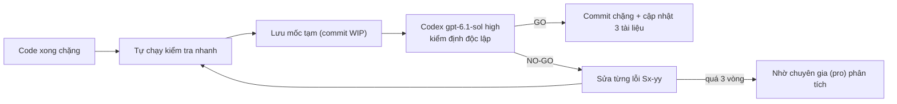

# KẾ HOẠCH TINH GỌN FLOW — GIAI ĐOẠN 10 (`v3.4.0`)

> **Mục tiêu dành cho Owner:** Giáo viên **bấm ít hơn**, **không phải nhớ thứ tự giữa các màn**, và bot **không còn chỗ chạy ngoài hàng đợi**. Sau mỗi chặng, **Codex CLI (`gpt-6.1-sol`, mức `high`)** sẽ kiểm định độc lập. Chỉ khi Codex kết luận **GO** mới sang chặng tiếp theo.

| Màn | Số bấm hiện tại | Mục tiêu |
| :--- | :---: | :---: |
| 1. Nhận xét buổi học | 5 | **3** |
| 2. Phiếu điểm | 4 | **2** |
| 3. SPCK Buổi 12/13 | 6 | **4** |
| 3. SPCK Buổi 14 | 10–11 | **~6** |
| 5. Dự án Teaching (mỗi buổi) | 1 (phải tự nhớ sang màn này) | **1 (được nhắc ngay ở Màn 3)** |

Nguồn phân tích: [FLOW_REVIEW.md](file:///C:/Users/QQ/.gemini/antigravity/brain/2dc5f134-f73b-44e2-9d14-6c8333eb3c3b/FLOW_REVIEW.md)

---

## 0. Các quyết định cần Owner chốt (đã điền sẵn phương án đề xuất)

| # | Câu hỏi | Đề xuất (mặc định nếu Owner không đổi) |
| :---: | :--- | :--- |
| Q1 | Hiện có **19 file đang sửa dở chưa lưu mốc** (`session14-eval-uploader.ts`, `final-project/page.tsx`…). Xử lý thế nào? | Chạy kiểm tra nhanh. Nếu đạt thì **lưu mốc nguyên trạng** làm điểm xuất phát, để lỡ hỏng vẫn quay lại được. |
| Q2 | Màn 1: khi bấm "AI soạn", các bạn **chưa điểm danh** có tự coi là **Có mặt** không? | **Có.** Trước khi soạn, hiện 1 dòng xác nhận "Coi N bạn chưa điểm danh là Có mặt?". Bạn nào đã đánh **Vắng** thì giữ nguyên. |
| Q3 | Phần **Tự chấm BTVN theo Barem** (đã ẩn khỏi giao diện): xóa hẳn hay giữ phần máy? | **Gỡ phần giao diện bị bỏ rơi.** Giữ phần máy và bài kiểm thử cũ (Phase 4/5) cho tới khi Owner nói xóa hẳn. |
| Q4 | Nộp SPCK Buổi 12/13/14 xong: tiến độ Teaching (60/80/100%) cập nhật thế nào? | **Hiện 1 nút gợi ý ngay trên Màn 3** ("Cập nhật tiến độ Teaching lên 80%"). Không tự đẩy khi chưa bấm. |
| Q5 | Màn 3: sau "Quét & Khớp HV" có **tự chạy công cụ** (chụp App, đưa Web lên GitHub, lấy YouTube, đẩy Drive) không? | **Có, nhưng có công tắc tắt/bật** (mặc định bật). Công cụ chạy **trước** bước Duyệt. |

---

## 1. Quy trình kiểm định Codex sau mỗi chặng (áp dụng cho S1 → S8)



**Lệnh gọi Codex** (chạy nền, không cần gõ phím; mỗi vòng lưu thành 1 file báo cáo):

```powershell
Get-Content docs/audits/v340/prompts/S<N>_R<k>.md -Raw |
  codex exec -m gpt-6.1-sol -c model_reasoning_effort="high" -c approval_policy="never" `
  -s workspace-write -o docs/audits/v340/CODEX_S<N>_ROUND<k>.md -
```

**Khung lời nhắn gửi Codex** (`docs/audits/v340/prompts/TEMPLATE.md`), lần nào cũng gồm:

1. **Thông tin chặng:** tên chặng, mốc so sánh `git diff <base>..HEAD`, danh sách file thay đổi, các mục checklist đã làm.
2. **Đọc trước khi kiểm:** `PROJECT_STATE.md` → `MINDX_AUTOMATION_PLAN.md` → `AGENTS.md` (6 nhóm quy tắc) → kế hoạch này.
3. **Ràng buộc an toàn cho Codex:**
   - Không sửa mã ứng dụng.
   - Mọi bài kiểm thử dùng `MINDX_DB_PATH`, `MINDX_RUNNING_CLASSES_PATH` và allowlist trỏ vào thư mục TEMP.
   - Không mở, không băm, không chép DB thật.
   - Không gửi yêu cầu thật lên LMS hay Teaching.
   - Không sửa `next-env.d.ts` và `docs/audits/round-12..41`.
4. **Bắt buộc chạy mới các cổng kiểm thử** của chặng (mục "Cổng kiểm thử" từng chặng) và báo exit code.
5. **Kết luận:** `GO` / `NO-GO`, kèm bảng lỗi mã `S<N>-xx` gồm mức độ (HIGH/MEDIUM/LOW), file:line và cách tái hiện. Từ vòng 2 trở đi thêm cột "CLOSED / OPEN" cho từng lỗi cũ.

**Cổng kiểm thử nền (chạy ở mọi chặng):**

```text
npx tsc --noEmit --incremental false
npx tsx scripts/test-phase5.ts
npx tsx scripts/test-phase6.ts
npx tsx scripts/test-phase7.ts
npx tsx scripts/test-phase4-codex-repros.ts
npx tsx scripts/test-spck-v270.ts
npx tsx scripts/test-spck-v272.ts
npx tsx scripts/test-lms-reliability-v280.ts
npx tsx scripts/test-session14-v290.ts
npx tsx scripts/test-teaching-project-v320.ts
npx tsx scripts/test-report-card-v330.ts
```

> [!IMPORTANT]
> **Ranh giới kiểm thử cũ không được phá:**
> - Giữ thứ tự 5 hook `useState` đầu tiên và dòng `\n  return (\n    <div className="space-y-6">` trong `final-project/page.tsx` (harness `round-38`).
> - Giữ nhánh DOM giả lập `[data-student-id]` khi `skipNavigation === true` trong `spck-uploader.ts`.

---

## 2. Checklist chi tiết từng chặng

### S0 — Chuẩn bị & chốt mốc xuất phát (HOÀN TẤT — GO)
- [x] S0.1 Chạy toàn bộ cổng kiểm thử nền trên mã hiện tại (gồm cả 19 file đang sửa dở). Ghi kết quả vào `docs/audits/v340/BASELINE.md`.
- [x] S0.2 Chốt Q1 với Owner, rồi commit `chore: snapshot before v3.4.0 streamlining` (`d7e3fe8`).
- [x] S0.3 Tạo `docs/audits/v340/prompts/TEMPLATE.md` (khung lời nhắn Codex ở mục 1).
- [x] S0.4 Thêm mục **Giai đoạn 10 (`v3.4.0`)** kèm checklist này vào `MINDX_AUTOMATION_PLAN.md`; cập nhật `PROJECT_STATE.md` và `CHANGELOG.md` (mục "Đang thực hiện").
- [x] S0.5 Gọi Codex kiểm **mốc xuất phát**: xác nhận cổng kiểm thử nền đạt và ghi lại các lỗi có sẵn từ trước, để sau này không quy nhầm thành lỗi mới. → `CODEX_S0_BASELINE.md`, `CODEX_S0_ROUND2.md` (**GO**)

### S1 — Sửa lỗi an toàn (ưu tiên cao nhất) (HOÀN TẤT — GO)
*Owner thấy gì:* bấm "Quét lớp" ở Màn 3 không còn giẫm lên việc bot đang làm; danh sách lớp ở các màn khác không tự mất lớp; Màn 5 không bị treo và dừng được bằng nút Stop.

- [x] **S1.1** `api/spck/list/route.ts`: đưa `fetchRunningClasses({ persistToConfig: false })` và `syncClass()` vào `taskQueue.enqueue` (đúng cách `session-comments/fetch-classes` đang làm).
- [x] **S1.2** Bỏ việc **tự xóa bớt lớp** khỏi `running_classes.json` trong route SPCK (dòng ~406–412) và truyền `{ persistToConfig: false }` vào `ClassSyncer.fetchRunningClasses`. Việc lọc lớp đã kết thúc chỉ áp dụng khi hiển thị danh sách ở Màn 3.
- [x] **S1.3** Tách bộ kết nối Teaching dùng chung `src/lib/teaching/teaching-http-client.ts`, lấy bản của Phiếu điểm vì đã có giới hạn chờ và nút Stop:
  - [x] Gồm `resolveTeachingBaseOrigin`, `ensureLoggedIn`, `getJson`/`postForm` có thử lại khi hết phiên (401/302), `fetchWithStopAndTimeout`, `runWithStopGuard`, `getStudentsOfClass` (có bộ nhớ đệm nguyên bản theo `origin + username + classCode`).
  - [x] `teaching-project-service.ts` và `teaching-report-card-sync.ts` cùng dùng client này, chung 1 phiên đăng nhập.
  - [x] Giữ nguyên các điểm cắm (interface transport) mà `test-teaching-project-v320.ts` và `test-report-card-v330.ts` đang thay thế bằng bản giả.
- [x] **S1.4** Phiếu điểm & Dự án Teaching: cho **thử đồng bộ lại khi trạng thái `FAILED`** nếu nội dung vẫn khớp khóa đã duyệt:
  - [x] Backend (`teaching-report-card-sync.ts` & `teaching-project-service.ts`) nhận `FAILED` khi hash khớp.
  - [x] UI (`teaching-report-card-view.tsx`) mở nút khi ở `FAILED`.
- [x] **S1.5** `final-project/page.tsx` ~1136: đọc đúng `selectedSessionNumber`, vẫn giữ đường dự phòng.
- [x] **S1.6** `spck-uploader.ts` ~792: bỏ mã buổi học viết cứng của `VT-C4K-PTA12`, luôn lấy và kiểm tra định dạng mã 24-hex thật từ SQLite hoặc LMS.
- [x] **S1.7** Ghi rõ trong `AGENTS.md`/`GEMINI.md`/`PROJECT_STATE.md`: **cổng thu bài học sinh** (`0.0.0.0` + đường hầm) là **ngoại lệ có chủ đích** của quy tắc chỉ `127.0.0.1`, chỉ mở khi giáo viên bấm, có mã bảo vệ `sessionToken`.
- [x] **S1.8** Viết `scripts/test-streamline-v340-s1.ts`:
  - [x] Route SPCK list POST xếp đúng 1 tác vụ vào hàng đợi và không ghi đè `running_classes.json`.
  - [x] Client Teaching dùng chung: bấm Stop giữa chừng thì dừng; quá thời gian thì báo lỗi; chỉ đăng nhập 1 lần cho 2 service.
  - [x] Đồng bộ lại được từ `FAILED` khi hash khớp; bị từ chối khi hash lệch.
- [x] **Cổng:** cổng nền + `test-streamline-v340-s1.ts` → **Codex S1** (`CODEX_S1_ROUND1.md`, `CODEX_S1_ROUND2.md`) → **GO** → commit `fix(v3.4.0-S1): ...` + cập nhật 3 tài liệu.

### S2 — Nền tảng dùng chung: 1 danh sách lớp, 1 ô chọn lớp
*Owner thấy gì:* cùng một danh sách lớp ở mọi màn, màn nào cũng nhớ lớp vừa chọn, chỉ còn 1 chỗ "Quét lại từ LMS".

- [x] **S2.1** Tạo `src/lib/classes/class-directory.ts`:
  - [x] `listClasses({ scope: 'running' | 'spck' | 'all', includeFinishedDays = 15 })`.
  - [x] 1 bộ lọc lớp thử nghiệm duy nhất `/^(TEST|AUDIT|R\d+|CLASS_|SYNTH)/`.
  - [x] 1 quy tắc giữ lớp 15 ngày sau khi kết thúc; `scope: 'spck'` thêm điều kiện buổi ≥ 12.
  - [x] `listStudents(classId, { activeOnly })` dùng thống nhất.
- [x] **S2.2** Thay 5 bản chép tay bằng hàm chung, **giữ nguyên dạng dữ liệu trả về** của từng route:
  - [x] `session-comments/list` (`buildMergedRunningClasses`)
  - [x] `session-comments/fetch-classes` (`getMergedRunningClasses`)
  - [x] `report-card` (`listAvailableClassesForReportCard`)
  - [x] `teaching-projects` (`listAvailableClassesForTeaching`)
  - [x] `spck/list` (`queryEligibleSpckClasses`)
  - [x] `homework-grader/scores` (`runningClasses`)
- [x] **S2.3** Route mới `POST /api/classes/refresh`: **1 tác vụ hàng đợi** gồm quét danh sách lớp, sau đó đồng bộ lớp đang chọn (tùy chọn). Thay cho việc trình duyệt phải gọi 2 lần như hiện nay.
- [x] **S2.4** Component `src/components/class-picker.tsx`:
  - [x] Ô chọn lớp, mục "📥 Quét lại từ LMS" (gọi S2.3), hiển thị thời điểm đồng bộ gần nhất.
  - [x] Đọc/ghi `localStorage.mindx_last_class_code`.
  - [x] Thuộc tính `scope` để Màn 3 chỉ hiện lớp ≥ Buổi 12.
- [x] **S2.5** Gắn `ClassPicker` vào Màn 1, 2, 3, 5:
  - [x] Màn 1: thay ô chọn + nút "Đồng bộ lớp" + mục "Quét lại" (3 chỗ) bằng 1 ô chọn. Giữ 1 nút nhỏ "🔄 Đồng bộ buổi học" cho lớp đang chọn.
  - [x] Màn 2: bỏ các nút lớp "Lớp đang dạy" bên trong phiếu điểm, chỉ còn 1 ô chọn ở đầu trang.
  - [x] Màn 3: dùng `scope='spck'`, **giờ đã nhớ lớp lần trước**; thay nút "Quét lớp TK GV". Không đổi thứ tự 5 `useState` đầu tiên.
  - [x] Màn 5: dùng chung, bỏ ô gõ tay trùng lặp.
- [x] **S2.6** `scripts/test-streamline-v340-s2.ts`:
  - [x] Cùng một dữ liệu DB/JSON giả thì 5 route trả **cùng một tập lớp** (theo scope).
  - [x] Lớp thử nghiệm bị loại; lớp kết thúc 14 ngày còn hiện, 16 ngày thì ẩn.
  - [x] `refresh` chỉ tạo 1 tác vụ hàng đợi.
- [x] **Cổng:** cổng nền + S1 + S2 → **Codex S2** (`CODEX_S2_ROUND1.md`, `CODEX_S2_ROUND2.md`, `CODEX_S2_ROUND3.md`) → **GO** → commit `feat(v3.4.0-S2): unified class-directory and shared ClassPicker` + 3 tài liệu.

### S3 — Màn 1 "Nhận xét buổi học": 5 bấm → 3 bấm
*Owner thấy gì:* chỉ còn **AI soạn → Duyệt & Đẩy LMS → Copy Zalo**.

- [x] **S3.1** Endpoint lưu nháp hàng loạt `POST /api/session-comments/save-draft` (nhận mảng):
  - [x] Điểm danh cả lớp và gắn thẻ mặc định chỉ còn **1 lần gọi**, thay vì N lần.
  - [x] Ô ghi chú và ô nhận xét **chờ 600ms sau khi ngừng gõ** mới lưu; tự lưu ngay khi rời ô hoặc rời trang.
- [x] **S3.2** Theo Q2: khi bấm "AI soạn", nếu còn bạn **chưa điểm danh** thì hiện xác nhận "Coi N bạn là Có mặt?". Đồng ý thì điểm danh hàng loạt rồi soạn luôn.
  - [x] Nút "⚡ Điểm danh cả lớp" vẫn giữ nhưng chuyển thành nút phụ.
- [x] **S3.3** Nút chính **"✅ Duyệt & Đẩy LMS (Buổi N)"**:
  - [x] Bước 1: duyệt hàng loạt **một lần gọi** `POST /approve` (mảng), chỉ các dòng có mặt, có nội dung, không ở trạng thái `INSUFFICIENT_INFO`/`FAILED` do AI. Khóa SHA-256 tính đúng trên chữ sắp đẩy.
  - [x] Bước 2: gọi ngay `save-lms` (hàng đợi, đọc lại để đối chiếu như cũ).
  - [x] Hiện tóm tắt: "Đã lưu X / Bỏ qua Y (thiếu thông tin) / Lỗi Z".
  - [x] Dòng lỗi có nút **"Thử lại"**.
- [x] **S3.4** Mỗi dòng học viên chỉ còn **1 nút** "Duyệt & Lưu riêng", thay cho 2 nút "Duyệt" rồi "Lưu thử vào LMS".
- [x] **S3.5** Buổi Checkpoint (Lập trình 5 & 9 / Robotics 4 & 8): nếu dòng còn `APPROVED` vì giáo viên chưa tích ĐNL, hiện thông báo dễ hiểu: *"Thầy hãy tích Điểm Năng lực trên LMS rồi bấm Đẩy lại"*. **Không** đụng vào ô ĐNL (quy tắc 3).
- [x] **S3.6** Tin Zalo **chỉ còn 1 bộ tạo**:
  - [x] Chuyển `buildAutoZaloBroadcastText`, `formatShortZaloName`, `addDaysToDdMmYyyy` từ page ra `src/lib/zalo/zalo-summary.ts` (hàm thuần, dùng được phía client, không có bí mật).
  - [x] Xóa `ZaloBroadcastGenerator.generate()` không dùng. Giữ `buildBtvnPart2`.
  - [x] Kiểm tra đúng mẫu SKILL `nhan-xet-hoc-sinh-zalo`: 6 mục, +7 ngày, Phần 2 chỉ xuất khi có ảnh, tên rút gọn.
- [x] **S3.7** Dọn dẹp:
  - [x] Dùng `isCheckpointSession` / `resolveCheckpointSessionsForClass` thay cho đoạn tính tay (~1964–1985).
  - [x] Xóa nhánh chết `"Em ${fullName} …"` trong `handleTextEdit` (vi phạm quy tắc không ghi tên).
  - [x] Hiện lại bộ đếm gọn "Có mặt X/Y • Đã duyệt • Đã lưu LMS".
  - [x] Xóa 3 khối `{false && …}` còn lại.
- [x] **S3.8** `scripts/test-streamline-v340-s3.ts`:
  - [x] Lưu hàng loạt và giữ thẻ "nhớ từ buổi trước" (không tái phát lỗi `R2-01`/`R2-02` của v3.1.1).
  - [x] "Duyệt & Đẩy" chỉ duyệt dòng hợp lệ; sửa chữ sau khi duyệt thì rớt về nháp.
  - [x] Buổi 14 vẫn bị chặn ở Màn 1.
  - [x] Zalo đúng mẫu (so sánh chuỗi mẫu).
- [x] **Cổng:** cổng nền + S1–S3 → **Codex S3** (`CODEX_S3_ROUND1.md` .. `CODEX_S3_ROUND5.md`) → **GO** → commit `feat(v3.4.0-S3): streamline session-comments 5->3 clicks and unify Zalo summary engine` + 3 tài liệu.

### S4 — Màn 2 "Phiếu điểm": 4 bấm → 2 bấm (ĐÃ HOÀN TẤT — GO)
*Owner thấy gì:* **Quét → Duyệt & Đồng bộ Teaching**, kèm cảnh báo khi dữ liệu Buổi 14 đã mới hơn bản quét.

- [x] **S4.1** Chỉ còn **1 nút Quét** (giữ nút trong phiếu điểm, bỏ nút xanh ở đầu trang).
  - [x] Backend: chọn `POST /api/homework-grader/scores` làm đường chuẩn (`enqueueScrapeClassScores`). Cho nhánh `scrape_lms` trong `/api/report-card` gọi cùng hàm, cập nhật test RC tương ứng.
- [x] **S4.2** Nút gộp **"✅ Duyệt & 🚀 Đồng bộ Teaching"**: duyệt (kèm `expectedVersion`) rồi đồng bộ ngay, giữ nguyên bước đọc lại để đối chiếu. Vẫn giữ nút "Chỉ duyệt" phụ cho ai chưa muốn đẩy.
- [x] **S4.3** **Cảnh báo dữ liệu cũ:** nếu `spck_session14_evaluations` có dữ liệu mới hơn bản quét hoặc điểm lệch (`computeReportCardStaleness` khớp 100% logic chọn nguồn của `ScoreScraper`), hoặc điểm Checkpoint chưa có, hiện băng vàng cảnh báo kèm nút *"🔄 Quét lại ngay"*.
- [x] **S4.4** Gộp tab "Ma trận bài nộp BTVN" thành mục **"Chi tiết bài nộp"** thu gọn trong phiếu điểm. Dùng **1 hàm định dạng** (`export-cell-formatter.ts`) cho Excel và cho TSV, thay cho `formatCellForExport` và `formatCellForTsv`.
- [x] **S4.5** Hết tải 2 lần khi mở trang: không đưa `updatedAt` của bản lưu sẵn vào `scrapeTrigger`, truyền `scrapeTrigger=""`.
- [x] **S4.6** Dọn: PUT `approve` trùng (`executeApproveReportCard`), các trường `rubrics`/`sessions`/`students` thừa, `Boolean(0)`, `{false && …}`.
- [x] **S4.7** `scripts/test-streamline-v340-s4.ts`:
  - [x] Duyệt & Đồng bộ trong 1 thao tác; xung đột phiên bản trả 409 và không đẩy.
  - [x] Cảnh báo dữ liệu cũ bật/tắt đúng (kể cả trùng tên học viên, trạng thái chờ duyệt 0/0 và mã CRM).
  - [x] TSV và Excel cùng một định dạng.
- [x] **Cổng:** cổng nền + S1–S4 → **Codex S4** (`CODEX_S4_ROUND1.md` .. `CODEX_S4_ROUND3.md`) → **GO** → commit + 3 tài liệu.

### S5 — Màn 3 "Upload SPCK" (chặng lớn nhất, chia 2 phần)

#### S5a — Chia nhỏ trang, KHÔNG đổi hành vi
- [x] **S5a.1** Tách `final-project/page.tsx` (~6.800 dòng) thành các component trong `src/components/final-project/`: `Step1Header`, `ToolsDrawer` (Drive, cổng thu bài, Demo), `StudentTable` + `StudentRow`, `SubmitBar`, `Session14Panel`, `FolderBrowserModal`, `SnapshotModal`. Chuyển các hàm xử lý vào hook `useSpckWorkflow`.
- [x] **S5a.2** Giữ nguyên **thứ tự 5 `useState` đầu tiên** (cùng toàn bộ 59 `useState`) và dòng `return (` theo đúng harness `round-38`.
- [x] **S5a.3** Chụp ảnh giao diện trước và sau (Playwright cục bộ, dữ liệu giả + CSS thật biên dịch qua `@tailwindcss/postcss`) trên 9 kịch bản (`sess12`, `sess13`, `sess14`, `snapshot-modal`, `folder-modal`, `banner-error`, `banner-success`, `banner-warning`, `busy-uploading`) để chứng minh không đổi hành vi/giao diện.
- [x] **Cổng:** cổng nền (đặc biệt `test-spck-v270`, `v272`, `session14-v290`, `phase6`) → **Codex S5a** (`CODEX_S5A_ROUND1.md`, `CODEX_S5A_ROUND2.md` — kiểm "không đổi hành vi") → **GO** → commit.

#### S5b — Rút gọn thao tác: Buổi 12/13 từ 6 → 4 bấm, Buổi 14 từ ~11 → ~6 bấm
- [ ] **S5b.1** Theo Q5, **tự chạy công cụ sau "Quét & Khớp HV"** (có công tắc, mặc định bật) theo ma trận 5 nhánh thống nhất:
  - [ ] **Web (`JSB/JSA/JSI/WEB/HTML` hoặc có file `.html`):** tự chụp giao diện Web + AI chọn ảnh bìa 16:9 → đưa lên GitHub Pages → tải lên Google Drive và gắn link.
  - [ ] **App / Python / Scratch / Game (`PTA/PTI/CSI/CSA/GMA/GMI` hoặc có file `.ui/.py/.sb3/.apk/.exe`):** tự chụp giao diện App + AI chọn ảnh bìa 16:9 → tải lên Google Drive và gắn link.
  - [ ] **Canva / Thiết kế (`CANVA/DESIGN` hoặc chỉ có ảnh/PDF/slide thiết kế):** tự tải lên Google Drive và gắn link (bỏ qua chụp App và GitHub Pages).
  - [ ] **Robotics có link Playlist YouTube:** tự lấy YouTube (2 ảnh thuyết trình) → tải lên Google Drive và gắn link.
  - [ ] **Robotics không có link Playlist YouTube:** tự tải lên Google Drive và gắn link.
  - [ ] Tất cả chạy qua hàng đợi, truyền tiếp `draftVersion` mới nhất qua từng bước, **trước** bước Duyệt. Hiện tiến trình từng bước.
- [ ] **S5b.2** Chạy Drive/GitHub/ảnh **sau khi đã duyệt** thì hỏi trước: *"Bài của N bạn sẽ phải duyệt lại, tiếp tục?"*. Không để rớt duyệt mà không báo.
- [ ] **S5b.3** Mỗi công cụ chỉ còn **1 nơi bấm** (trong ngăn Công cụ). Dòng học viên chỉ giữ nút **"Thử lại"** khi công cụ đó lỗi.
- [ ] **S5b.4** Buổi 14 gộp:
  - [ ] **"AI soạn tất cả"**: Bình luận SPCK 2 mục + Thư từ MindX 3 phần, chạy liên tiếp.
  - [ ] **"Nộp Buổi 14 đầy đủ (Sản phẩm + Đánh giá)"**: duyệt rồi đẩy dây chuyền Sản phẩm (cột 3), sau đó dây chuyền Đánh giá (cột 2). Cả 2 qua hàng đợi, **giữ trạng thái riêng từng phần**; phần nào lỗi thì thử lại riêng phần đó.
  - [ ] Phần Đánh giá Buổi 14 chuyển thành **tab thứ 2 trong từng dòng học viên**, thay cho danh sách riêng phía dưới.
- [ ] **S5b.5** Mở Buổi 14 mà đã có link Bảng chấm Demo hoặc file `.xlsx` trong thư mục lớp thì **tự đọc Điểm Demo**. Hiện lại ô nhỏ để dán link khác (thay cho khối ẩn ~6229).
- [ ] **S5b.6** Buổi 13: tự chọn sẵn "chưa nộp Buổi 13"; AI nhận gợi ý "nêu tiến bộ so với Buổi 12".
- [ ] **S5b.7** Xóa các khối `{false && …}` (4381, 4664, 5084, 6229).
- [ ] **S5b.8** Giữ đúng quy tắc: tiêu đề và bình luận AI **không** ghi `GĐ1/GĐ2/Buổi 12/13/14`; thiếu ảnh thì dùng **Logo MindX**; không bao giờ tự bỏ ảnh của Owner.
- [ ] **S5b.9** `scripts/test-streamline-v340-s5.ts`:
  - [ ] Chuỗi tự chạy công cụ đúng theo loại lớp.
  - [ ] Có cảnh báo rớt duyệt.
  - [ ] "Nộp Buổi 14 đầy đủ" gọi đúng 2 dây chuyền theo thứ tự; lỗi một phần không làm hỏng phần kia.
  - [ ] Tự đọc Demo.
- [ ] **Cổng:** cổng nền + S1–S5 → **Codex S5b** → GO → commit + 3 tài liệu.

### S6 — Màn 5 + nối các màn với nhau
*Owner thấy gì:* không còn phải tự nhớ "giờ làm gì tiếp".

- [ ] **S6.1** Màn 5: 1 nút **"Cập nhật tiến độ theo buổi hiện tại"** (Buổi 11 → 20% … Buổi 14 → 100%). 6 nút mốc, các nút 100%/0% từng việc, sửa từng ô và "Lấy ngày từ LMS" chuyển vào mục **"Nâng cao"** thu gọn.
- [ ] **S6.2** Theo Q4: nộp SPCK Buổi N trên Màn 3 thành công (`VERIFIED`) thì hiện thẻ gợi ý **"📈 Cập nhật tiến độ Teaching lên X%"**, bấm 1 lần là đẩy (qua hàng đợi, có đọc lại đối chiếu).
- [ ] **S6.3** Buổi 14: sau khi "Nộp Buổi 14 đầy đủ" thành công, gợi ý **"Mở Phiếu điểm → Quét"**. Đi kèm cảnh báo dữ liệu cũ ở S4.3.
- [ ] **S6.4** Trang chủ: thẻ **"Việc cần làm hôm nay"** cho từng lớp, dựa trên buổi hiện tại và trạng thái đã lưu. Ví dụ:
  - Buổi 7: "Nhận xét buổi 7 (chưa đẩy LMS)".
  - Buổi 14: "① Nộp SPCK ② Đánh giá ③ Phiếu điểm ④ Tiến độ 100%".
  - Bấm vào là mở đúng màn, đúng lớp.
- [ ] **S6.5** Xóa các hành động `approve` / `approve_and_save` không dùng trong `api/teaching-projects/route.ts`, **sau khi** kiểm tra `test-teaching-project-v320.ts` không phụ thuộc (nếu có thì giữ lại).
- [ ] **S6.6** `scripts/test-streamline-v340-s6.ts`:
  - [ ] Ánh xạ buổi sang % đúng.
  - [ ] Gợi ý chỉ hiện khi đã `VERIFIED`.
  - [ ] "Việc cần làm" đúng cho các buổi 1, 5, 12, 14.
- [ ] **Cổng:** cổng nền + S1–S6 → **Codex S6** → GO → commit + 3 tài liệu.

### S7 — Dọn dẹp bên trong
- [ ] **S7.1** Theo Q3: gỡ `homework-auto-grader-tab.tsx` (chuyển kiểu `GradingRubric` sang `src/lib/types`). Giữ backend chấm bài + `test-phase5`/`test-lms-reliability-v280` cho tới khi Owner quyết xóa hẳn.
- [ ] **S7.2** Màn 4: xóa 2 tab Barem/Mẫu Zalo không mở được (~600 dòng); dữ liệu JSON vẫn giữ. Chuyển mục "Giáo trình & Thẻ" từ thanh menu chính sang nút **⚙ Cài đặt** ở góc phải.
- [ ] **S7.3** **1 bộ ẩn tên học sinh dùng chung** `src/lib/ai/pii-anonymizer.ts` (`anonymize` / `deanonymize`, dựa trên `vietnamese-match.ts`), thay cho 5 bản riêng trong `comment-generator`, `homework-grader`, `session14-course-summary`, `spck-comment`, `teaching-project-generator`.
  - [ ] Kiểm thử: họ tên đầy đủ, tên đệm + tên, tên gọi 1 từ, viết không dấu, trùng tên; không lọt tên nào ra lời nhắn gửi AI.
- [ ] **S7.4** Gom các hàm bỏ dấu tiếng Việt viết lại cục bộ (`sqlite.ts`, `scrape-scores.ts`, `spck-demo-score-reader.ts`, `spck-uploader.ts`, `sync-class.ts`) về `vietnamese-match.ts`, **giữ** biến thể "giữ dấu thanh" mà Teaching cần.
- [ ] **S7.5** *(Tùy chọn, rủi ro cao hơn, Owner có thể bỏ qua)* Khuôn chung "Duyệt / Khóa / Đánh dấu đã lưu" `approveWithHash` / `markVerifiedIfHash` / `demoteOnChange` cho 7 kho dữ liệu trong `sqlite.ts`, cùng hàm `parseExpectedVersion` + trả lỗi 409 chung cho các route.
- [ ] **S7.6** Quét lại toàn bộ `{false && …}` / `Boolean(0)`: còn 0 chỗ.
- [ ] **Cổng:** cổng nền + S1–S7 + kiểm thử ẩn danh → **Codex S7** → GO → commit + 3 tài liệu.

### S8 — Nghiệm thu tổng & bàn giao
- [ ] **S8.1** Chạy toàn bộ cổng nền + `test-streamline-v340-s1..s7` + `npm run build`.
- [ ] **S8.2** **Codex kiểm định tổng** `v3.4.0`: so sánh với mốc S0, rà 6 nhóm quy tắc `AGENTS.md`, đếm lại số bấm từng màn so với mục tiêu. → `CODEX_V340_FINAL.md`
- [ ] **S8.3** Cập nhật `PROJECT_STATE.md` (bản đồ file mới, luồng mới), `CHANGELOG.md` (`v3.4.0`), `MINDX_AUTOMATION_PLAN.md` (đánh dấu xong Giai đoạn 10), đổi nhãn phiên bản trên thanh menu và trang chủ.
- [ ] **S8.4** Viết **phiếu thử thật cho Owner** (ngôn ngữ đời thường, ~10 bước) để chạy trên 1 lớp thật: Nhận xét 1 buổi → Phiếu điểm → SPCK Buổi 12 (lớp thử) → tiến độ Teaching.
- [ ] **S8.5** Báo cáo Owner theo mẫu 3 phần: Kết quả chính / Giáo viên được lợi gì / Bước tiếp theo.

---

## 3. Rủi ro & cách phòng

| Rủi ro | Cách phòng |
| :--- | :--- |
| Gộp "Duyệt & Đẩy" làm mất lớp khóa nội dung đã duyệt | Vẫn duyệt kèm SHA-256 ngay trước khi đẩy; bot chỉ nhận dòng đã duyệt (logic `save-comments` / sync không đổi). Codex kiểm riêng điểm này ở S3/S4. |
| Tách Màn 3 làm vỡ harness kiểm thử cũ | S5a chỉ tách, không đổi hành vi; giữ thứ tự `useState`; chụp ảnh so sánh trước/sau. |
| Tự chạy công cụ (S5b.1) làm chậm hoặc hỏng | Có công tắc tắt; mọi việc qua hàng đợi, bấm Stop là dừng; lỗi một bước không chặn các bước sau. |
| Còn người khác sửa song song (19 file dở) | S0 chốt mốc trước; mỗi chặng commit riêng nên quay lại được từng chặng. |
| Codex không chạy được (mạng/giới hạn) | Báo Owner ngay, **không tự đánh dấu GO**; chờ chạy lại. |

## 4. Ước lượng

| Chặng | Khối lượng | Số vòng Codex dự kiến |
| :--- | :--- | :---: |
| S0 | Nhỏ | 1 |
| S1 | Vừa | 1–2 |
| S2 | Vừa | 1–2 |
| S3 | Vừa | 2 |
| S4 | Nhỏ–vừa | 1–2 |
| S5a | Lớn | 1–2 |
| S5b | Lớn | 2–3 |
| S6 | Vừa | 1–2 |
| S7 | Vừa (S7.5 lớn, tùy chọn) | 1–2 |
| S8 | Nhỏ | 1 |
